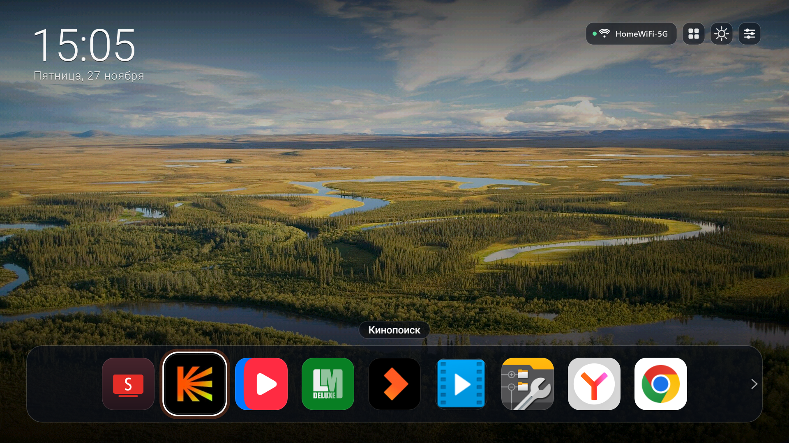
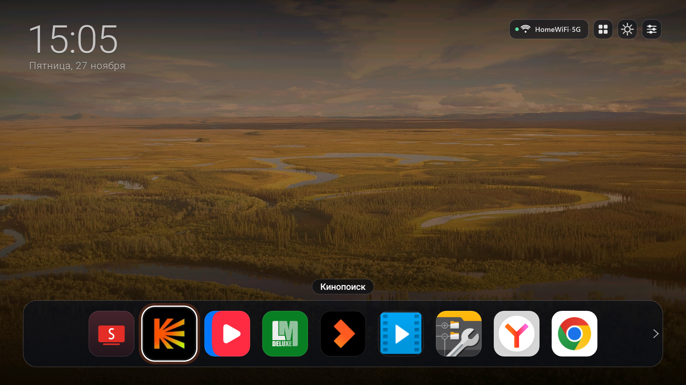
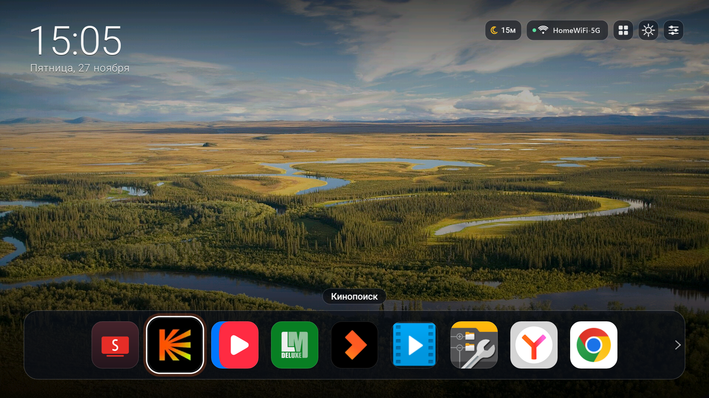
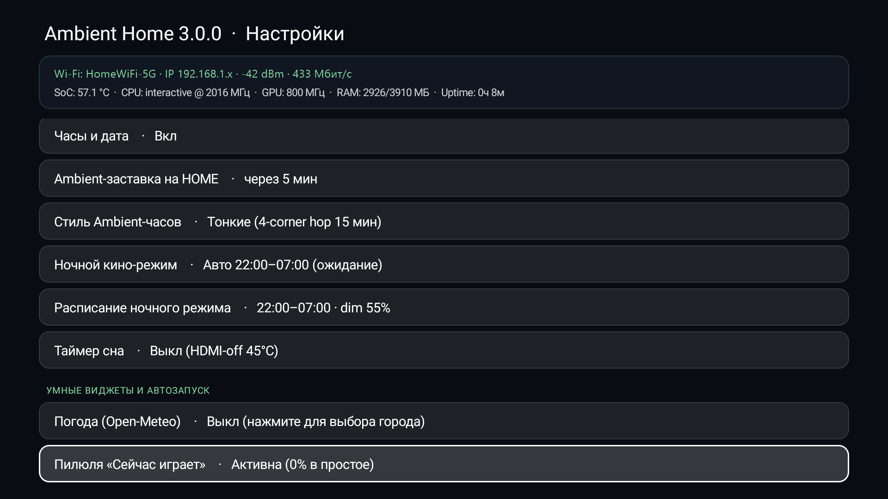

# Ambient Home

[](https://github.com/pavelcanton/ambient-home-tv/actions/workflows/ci.yml)
[](https://github.com/pavelcanton/ambient-home-tv/releases/latest)
[](LICENSE)

**Ultra-lightweight, ad-free, zero-bloat Android TV launcher & living-room ambient display — built in pure Kotlin with zero Gradle, zero AndroidX, ~25 MB RAM, and 0% idle GPU load.**

[Screenshots](#screenshots) · [Architecture](#architecture-highlights) · [Unrooted vs Root Bridge](#unrooted-stock-android-tv-vs-optional-root-bridge) · [Install](#installation) · [LAN Web Remote & REST API](#lan-web-remote-pwa--rest-api) · [Build from Source](#build-from-source) · [Privacy](#zero-telemetry-privacy-pledge) · [Обзор на русском](#обзор-на-русском)

> **Localization Note (v3.0.0):** The current on-screen TV UI and embedded Web Remote UI are **Russian-first (`ru`)**. The codebase has zero external dependencies and is straightforward to localize — community PRs adding English (`res/values/strings.xml`) and additional languages are very welcome! See [CONTRIBUTING.md](CONTRIBUTING.md).

---

## Screenshots

| Apple TV-style Dock | Night Cinema Mode (Zero-Shader Amber Tint) |
| :---: | :---: |
|  |  |

| Ambient Analog Clock (Burn-in Safe 4-Corner Hop) | Living-Room Sleep Timer Badge |
| :---: | :---: |
|  |  |

| Settings & Live Hardware Diagnostics |
| :---: |
|  |

---

## Key Features (v3.0.0)

- **Clean Dock & Grid Modes:** Apple TV-style translucent dock with pinned favorites (`★`), manual reordering, app hiding, and full-screen All Apps grid (`minSdk=26`, `targetSdk=33`).
- **4 Burn-in-Safe Ambient Clocks:** Thin, Cinema, Minimal, and Analog styles with 15-minute 4-corner burn-in hop and subtle pixel drift.
- **Auto-Night Cinema Mode:** Configurable schedule (default `22:00-07:00`) + Auto/On/Off toggle. Bakes warm amber tint and extra dimming directly into static `RGB_565` wallpapers off the UI thread (`0%` extra GPU load) and lowers clock luminance.
- **Quick Control Sheet:** Press the TopBar Quick button or `MENU` for 1-click Ambient Now, Next Wallpaper, Night Mode toggle, Sleep Timer, LAN Web Remote info (URL + PIN), Soft Wi-Fi Reconnect, and Safe USB Eject.
- **Living-Room Sleep Timer:** 15 / 30 / 60 / 90-minute countdown with TopBar & Ambient moon badge, 15-second cancelable pre-sleep warning, smooth volume fade-out + media pause, and transition to ultra-dim black Night Ambient (or true HDMI sleep when paired with an optional root bridge).
- **Zero-Scan Bluetooth Audio Indicator:** Passive `AudioManager.AudioDeviceCallback` showing a headphones badge only when BT A2DP / BLE headset audio is active — zero BT scanning.
- **Optional Smart Widgets:**
  - **Weather (Open-Meteo):** API-key-free weather pill & 4-day/hourly forecast dialog, RAM-only cache (refreshes at most every 45 min while `HOME` is active).
  - **Now Playing Pill:** Active media title/artist overlay via optional `NotificationListener` permission (`0%` idle cost).
  - **Photo of the Day Wallpapers:** Optional Bing `HPImageArchive` + Wikimedia Commons POTD rotation (max 3 cached validated JPEGs, automatic offline fallback) alongside 5 bundled nature wallpapers, custom `/sdcard/Pictures/Wallpapers` photos, and procedural gradients.
- **Embedded LAN Web Remote PWA & REST API:** Control your TV from any phone or PC browser on your local Wi-Fi (`http://<tv-ip>:8765`), protected by a random 6-digit `SecureRandom` PIN (`X-Auth-Token`) with rate limiting. Also integrates cleanly with **MacroDroid**, **Home Assistant**, or `curl`.
- **Wake-on-LAN PC Tile:** Virtual dock/grid tile to wake a LAN PC via UDP magic packet.
- **Wi-Fi-Aware Cold-Boot Auto-Launch:** Optionally launch a preferred TV app once per cold boot (tracked via `/proc/sys/kernel/random/boot_id`) after network readiness, with a cancelable countdown banner.
- **JSON Settings Backup & Restore:** Human-readable `ambient_home_backup.json` export/import covering dock order, pinned/hidden apps, appearance, night schedule, weather city, WoL target, and Web Remote settings.

---

## Architecture Highlights

Ambient Home is built specifically to feel instantaneous on modest ARM/Mali Android TV boxes while remaining rock-solid on flagship devices.

> **Battle-Tested 24/7 on HK1 RBOX K8 (Rockchip RK3528):** Soak-tested continuously on an **HK1 RBOX K8** (`Rockchip RK3528`, `4x Cortex-A53`, `Mali-450 MP`, `4 GB RAM`, `Android 13 / API 33`) at **~25.1 MB Total PSS**, **0% idle GPU**, **0 crashes**, and **0 Accessibility lag** — while remaining **100% compatible with any unrooted Android TV / Google TV box (API 26+)**. See [docs/HK1_RBOX_K8_NOTES.md](docs/HK1_RBOX_K8_NOTES.md) for optional RK3528 / Android 13 OS tuning notes.

| Metric | Value |
| --- | --- |
| **External Dependencies** | **0** — Pure Kotlin `2.1.10` + Android SDK (`android.jar` API 34) only (**0 AndroidX, 0 Jetpack, 0 Compose, 0 Gradle**) |
| **Memory Footprint** | **~25 MB Total PSS** (`1` Activity, `7` Views, `0` WebViews) |
| **Idle GPU Load** | **0%** — Wallpapers, scrims, night tints, and glass panels are pre-baked off the UI thread; zero continuous idle animations |
| **Codebase Structure** | **38 Deslop modules** — every `.kt` file `< 600` lines (max `540` L), functions `<= 50` L, strict acyclic DAG (`root -> {ui, data, model}`, `0` `data.*` in `ui/`), `0` HWUI `.recycle()` |
| **Automated Tests** | **491 pure-JVM unit tests** across 5 suites (run in seconds without an emulator) |
| **Release Binary** | **~3.9 MB R8-shrunk APK** with `apksigner` v2+v3 signatures, `zipalign -p 4`, and uncompressed 4-byte-aligned `STORED` `classes.dex` (`mod4=0`) for zero-copy ART `mmap` |

---

## Unrooted Stock Android TV vs Optional Root Bridge

Ambient Home works **100% unrooted** on stock Android TV / Google TV / AOSP TV devices. It never calls `su` or bundles a root daemon.

| Feature | Unrooted Stock Android TV | With Optional Root Bridge (`files/remote.fifo`) |
| --- | :---: | :---: |
| Dock / Grid Launcher, Pinning, Reordering, Hiding | Yes | Yes |
| Bundled / Custom / Daily Wallpapers & Night Cinema Mode | Yes | Yes |
| 4 Ambient Clock Styles + 4-Corner Burn-in Hop | Yes | Yes |
| Weather Widget, BT Audio Badge, Cold-Boot Auto-Launch, WoL | Yes | Yes |
| JSON Settings Backup / Restore | Yes | Yes |
| Now Playing Pill | Yes (via `adb` NotificationListener grant) | Yes |
| Sleep Timer (volume fade + media pause + black Night Ambient) | Yes | Yes + optional true HDMI sleep (`KEYCODE_SLEEP`) |
| LAN Web Remote: Telemetry, App Launch, Night Mode, Sleep Timer, Wallpaper Upload, Config, WoL | Yes | Yes |
| LAN Web Remote: System-wide D-pad keys, Clipboard Paste, Force-Stop, AFR refresh rate, Safe USB Eject | Graceful notice (disabled) | Yes (allowlisted non-blocking FIFO commands — see [extras/root-bridge](extras/root-bridge/README.md)) |

---

## Installation

### Option 1: Quick-Install Script (Recommended)

Use the included quick-install script to connect via ADB, install `AmbientHome.apk`, run AOT `speed` compilation, optionally enable the Now Playing pill (`NotificationListener`), and set Ambient Home as the default launcher:

**Windows (PowerShell):**

```powershell
.\scripts\install-tv.ps1 -Device 192.168.1.x:5555 -NowPlaying -SetHome
```

**Linux / macOS (POSIX sh):**

```bash
chmod +x ./scripts/install-tv.sh
./scripts/install-tv.sh --device 192.168.1.x:5555 --now-playing --set-home
```

### Option 2: Manual ADB Install

Download `AmbientHome-3.0.0.apk` from [GitHub Releases](https://github.com/pavelcanton/ambient-home-tv/releases) (see [Release Notes v3.0.0](docs/RELEASE_NOTES_v3.0.0.md)) or [build from source](#build-from-source), verify its SHA-256 checksum, and install:

```bash
adb connect 192.168.1.x:5555
adb install -r AmbientHome.apk
adb shell cmd package compile -m speed -f com.will.ambienthome
```

Press **HOME** on your TV remote and select **Ambient Home -> Always**, or set it as default launcher via ADB:

```bash
adb shell cmd package set-home-activity com.will.ambienthome/.MainActivity
```

### Optional: Enable the "Now Playing" Pill

To display active playback metadata without root, grant `NotificationListener` access once via ADB (survives reboots):

```bash
adb shell cmd notification allow_listener com.will.ambienthome/com.will.ambienthome.data.AmbientNotificationListener
```

---

## LAN Web Remote PWA & REST API

When enabled (default **On**, toggleable **Off** anytime in Settings for `0%` background overhead), `LanWebRemoteService` listens on **`http://192.168.1.x:8765`** inside your local network.

- Open `http://192.168.1.x:8765` from a phone or computer on the same Wi-Fi and enter the 6-digit PIN shown in **Quick Controls -> Web Remote** or **Settings -> LAN Web Remote**.
- **Security:** All `/api/*` endpoints (except `/api/ping`) require header `X-Auth-Token: <6-digit PIN>` (constant-time verification, 5-failure 15s `429` lockout). Port `8765` uses unencrypted local HTTP for trusted home LANs — **never expose it to the Internet**. See [SECURITY.md](SECURITY.md) for the complete threat model.

### REST API Reference (MacroDroid / Home Assistant / `curl`)

| Method | Endpoint | Auth | Description |
| --- | --- | :---: | --- |
| `GET` | `/` | No | Embedded single-file Web Remote PWA (never embeds PIN) |
| `GET` | `/api/ping` | No | Health check (`{"ok":true,"app":"AmbientHome","version":"3.0.0"}`) |
| `GET` | `/api/status` | PIN | Live telemetry, Night Mode, Sleep Timer, Weather, installed apps, USB volumes, `bridgeAvailable` |
| `POST` | `/api/launch` | PIN | Launch app: `{"package":"org.example.app"}` |
| `POST` | `/api/action` | PIN | Trigger action: `night_toggle`, `night_on`, `night_off`, `night_auto`, `sleep_timer` (`{"action":"sleep_timer","minutes":30}`), `next_wallpaper`, `ambient_now`, `media_play_pause`, `media_next`, `wol`, `wifi_reconnect` |
| `POST` | `/api/config` | PIN | Update `weatherCity`, `wolName`/`wolMac`, `nightStart`/`nightEnd`, `clockStyle` |
| `POST` | `/api/wallpaper` | PIN | Upload JPEG/PNG (`<= 10 MiB`, raw binary body, header `X-Filename: photo.jpg`) |
| `POST` | `/api/key` | PIN | *(Optional root bridge)* Send Android keycode `1..300`: `{"code":23}` |
| `POST` | `/api/text` | PIN | *(Optional root bridge)* Set clipboard + paste UTF-8 text: `{"text":"hello"}` |
| `POST` | `/api/forcestop` | PIN | *(Optional root bridge)* Force-stop non-system app: `{"package":"org.example.app"}` |
| `POST` | `/api/action` (bridge) | PIN | *(Optional root bridge)* `hdmi_sleep`, `hdmi_wake`, `afr` (`{"action":"afr","fps":24}`), `usb_eject` (`{"action":"usb_eject","volume":"public:8,1"}`) |

#### Example (`curl` / MacroDroid HTTP Request)

```bash
# Toggle Night Cinema Mode from a phone shortcut or home automation
curl -X POST "http://192.168.1.x:8765/api/action" \
  -H "Content-Type: application/json" \
  -H "X-Auth-Token: <6-digit PIN>" \
  -d '{"action":"night_toggle"}'

# Start a 30-minute Sleep Timer
curl -X POST "http://192.168.1.x:8765/api/action" \
  -H "Content-Type: application/json" \
  -H "X-Auth-Token: <6-digit PIN>" \
  -d '{"action":"sleep_timer","minutes":30}'
```

---

## Build from Source

No Gradle or Android Studio required — builds cleanly from the command line in seconds.

### Windows (PowerShell 5.1+)

```powershell
# 1. One-time portable toolchain download (Temurin JDK 17, Kotlin 2.1.10, build-tools r34, platform-34)
#    Verifies pinned SHA-256 checksums and unpacks locally into .\tools\android-build\
.\fetch-toolchain.ps1

# 2. Run all 5 JVM unit test suites + R8 build + zipalign + apksigner verification
.\build.ps1
# Optional: skip JVM tests during quick UI iteration
.\build.ps1 -SkipTests
```

### Linux / macOS (Bash)

Provide JDK 17 (`JAVA_HOME`), Kotlin `2.1.10`, Android `build-tools r34`, and `android-34/android.jar` (either inside `./tools/android-build/`, via `AMBIENT_TOOLCHAIN_ROOT`, or individually via `AMBIENT_KOTLIN_HOME`, `AMBIENT_BUILD_TOOLS`, `AMBIENT_ANDROID_JAR` / `$ANDROID_HOME`):

```bash
chmod +x ./build.sh
./build.sh
# Optional: skip JVM unit tests
./build.sh --skip-tests
```

Both `build.ps1` and `build.sh` produce:
- `AmbientHome.apk` (verified with `apksigner` v2+v3, `zipalign -c -p 4`, and `VerifyDexZip` `STORED mod4=0`)
- `build/AmbientHome-3.0.0.apk.sha256`

### Release Signing (Optional Environment Variables)

Without signing variables, local builds automatically generate and sign with an ephemeral debug keystore at `build/debug.keystore`. For public or personal production releases, supply your own private release keystore via environment variables (never commit keystores to git):

| Variable | Required | Description |
| --- | :---: | --- |
| `AMBIENT_KEYSTORE` | Yes | Path to your `.keystore` / `.jks` file outside the repository |
| `AMBIENT_KEYSTORE_PASS` | Yes | Keystore password |
| `AMBIENT_KEY_ALIAS` | Yes | Signing key alias |
| `AMBIENT_KEY_PASS` | No | Key password (defaults to `AMBIENT_KEYSTORE_PASS` if omitted) |

---

## Zero-Telemetry Privacy Pledge

Ambient Home collects **zero analytics, zero crash telemetry, zero ads, and zero device identifiers**.

- Outbound HTTPS traffic happens **only** when you explicitly enable optional features:
  1. **Weather widget (Off by default):** queries [Open-Meteo](https://open-meteo.com/) for your selected city at most every 45 minutes while `HOME` is open.
  2. **Photo of the Day wallpapers (Off by default):** fetches up to 3 daily images from Bing `HPImageArchive` (fallback: Wikimedia Commons POTD) at most every 12 hours while `HOME` is open.
- **Bundled Wallpapers (`res/drawable-nodpi/w1..w5.jpg`):** All EXIF metadata is stripped cleanly from APK assets.
  - `w4.jpg` (Grand Teton Sunrise): C.J. Adams / U.S. National Park Service (Public Domain).
  - `w5.jpg` (Denali from Wonder Lake): Mary Lewandowski / U.S. National Park Service (Public Domain).
  - `w1.jpg`, `w2.jpg`, `w3.jpg`: Wikimedia Commons CC0 / Public Domain nature photography.

---

## Release Notes & Documentation

- [Release Notes (v3.0.0)](docs/RELEASE_NOTES_v3.0.0.md)
- [HK1 RBOX K8 (RK3528) Field Notes](docs/HK1_RBOX_K8_NOTES.md)
- [Optional Root Remote Bridge](extras/root-bridge/README.md)
- [Changelog](CHANGELOG.md)
- [Security Policy](SECURITY.md)
- [Contributing Guide](CONTRIBUTING.md)

---

## Обзор на русском

**Ambient Home 3.0.0** — сверхлёгкий лаунчер и Ambient-заставка для Android TV без рекламы, телеметрии, Gradle и AndroidX:

- **Производительность:** чистый Kotlin `2.1.10` + R8, ~25 МБ RAM (PSS), `0%` нагрузки на GPU в простое, мгновенный отклик даже на бюджетных ТВ-приставках (`minSdk=26`, `targetSdk=33`).
- **Возможности:** док в стиле Apple TV и сетка приложений, 4 стиля Ambient-часов с защитой от выгорания (перескок по 4 углам раз в 15 минут), авто-ночной кино-режим с тёплым янтарным запеканием, панель быстрых действий, таймер сна, индикатор Bluetooth-аудио без сканирования, погода Open-Meteo, пилюля «Сейчас играет», обои «Фото дня», Wake-on-LAN, автозапуск после холодного ребута, JSON-бэкап настроек и встроенный локальный LAN Web-пульт (`:8765`, защита 6-значным PIN).
- **Работает без root:** все основные функции и LAN Web-пульт работают на обычном Android TV без прав суперпользователя; при наличии опционального root-моста (`files/remote.fifo`) дополнительно открываются системные клавиши D-pad, вставка текста, принудительная остановка приложений, AFR и аппаратный сон HDMI.
- **Установка:** `adb install -r AmbientHome.apk` -> выберите **Ambient Home** как главный экран. Сборка из исходников: `.\fetch-toolchain.ps1` и `.\build.ps1` (Windows) или `./build.sh` (Linux/macOS).

---

## License

Licensed under the [MIT License](LICENSE).
